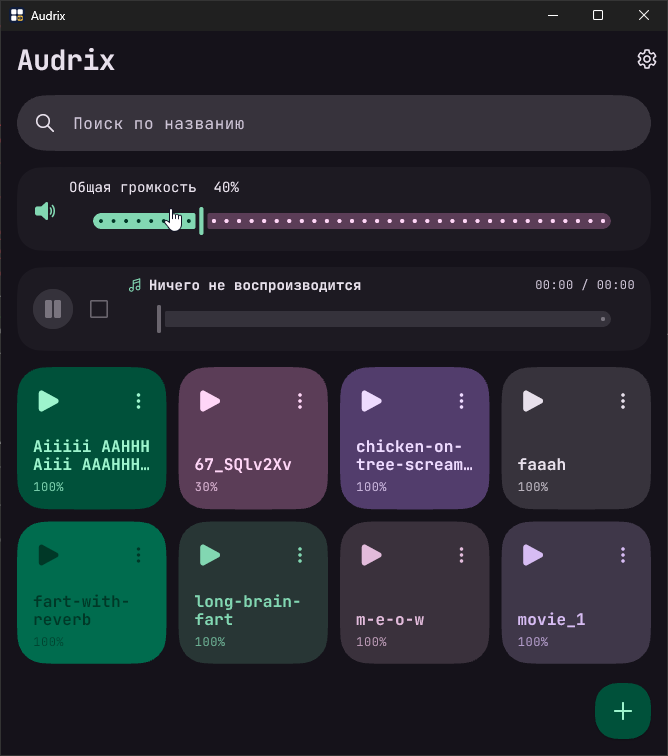
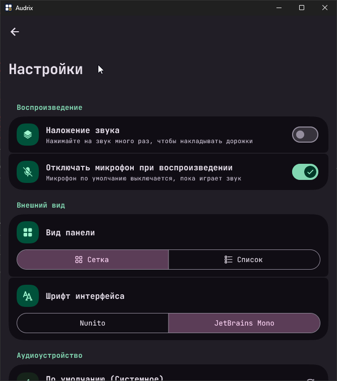

# Audrix

Звуковая панель для Windows. Звуки уходят в выбранное аудиоустройство (например, в виртуальный кабель для Discord), а при включённом мониторинге дублируются в наушники или колонки.

## Возможности

- Импорт `mp3`, `wav`, `ogg`, `flac`, `m4a`, `aac` файлами или целой папкой.
- Сетка или список, поиск, переименование, удаление, отдельная громкость для каждого звука.
- Наложение звуков друг на друга, пауза, перемотка, остановка по `Esc`.
- Выбор устройства вывода.
- Локальное прослушивание: звук слышите и вы, и собеседник.
- Отключение микрофона по умолчанию на время воспроизведения (Windows).
- Экспорт всех звуков в папку с `manifest.json` и обратный импорт.
- Два шрифта на выбор и системная светлая/тёмная тема.

Данные приложения лежат в `%APPDATA%\auren0\Audrix\soundpad`.

## Скриншоты

Положите файлы в `docs/screenshots/`:

- `main.png` — главное окно;
- `settings.png` — настройки.

Когда файлы будут на месте, раскомментируйте картинки:

<!--


-->

## Сборка

Нужны Flutter, Visual Studio с компонентом «Разработка классических приложений на C++» и Inno Setup 6.

```powershell
flutter pub get
flutter build windows --release
iscc windows\installer.iss
```

Готовый установщик появится в папке `dist` рядом с папкой проекта:
`Audrix-windows-x64-setup.exe`.

## Примечания

- Локальное прослушивание выводит звук на устройство Windows по умолчанию и работает, когда выбран конкретный выход, а не «Системное».
- Отключение микрофона доступно только в Windows.
- OGG в режиме локального прослушивания может не дублироваться системным кодеком; основной вывод в Discord при этом работает.
